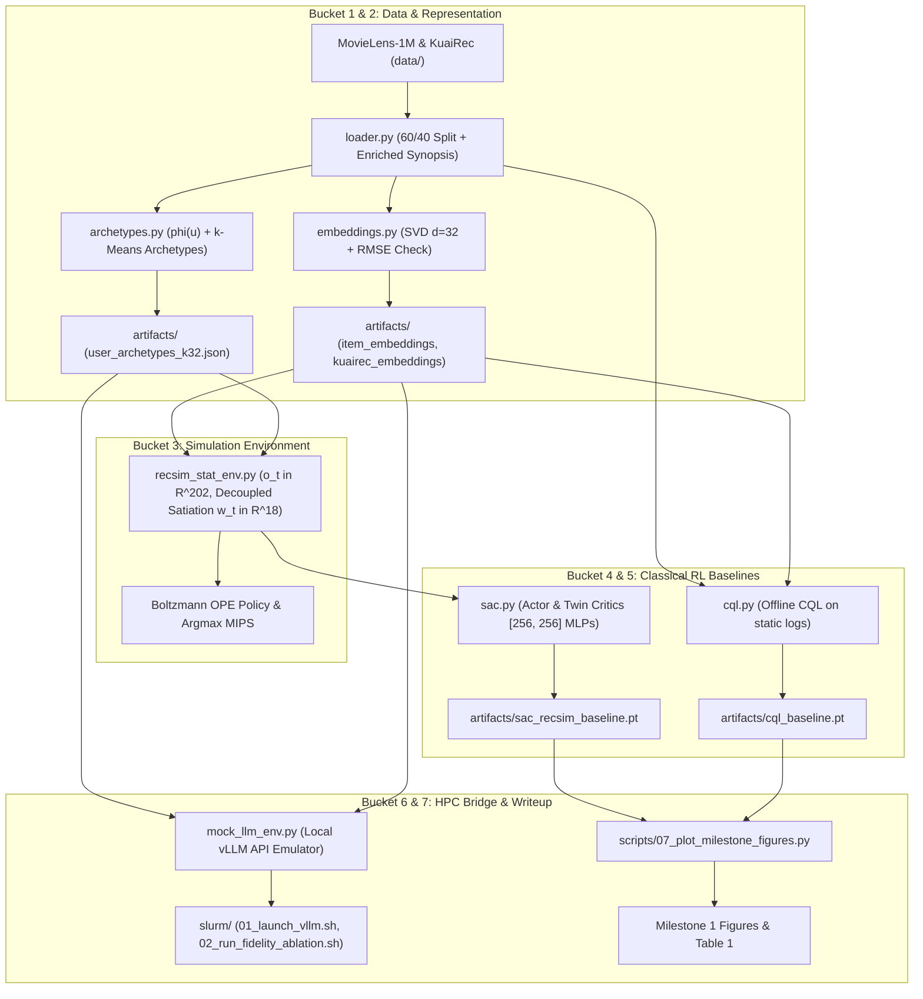

# Pre-Bouchet Pipeline & Baseline Infrastructure Implementation Plan

> **For agentic workers:** REQUIRED SUB-SKILL: Use superpowers:subagent-driven-development to implement this plan task-by-task. Steps use checkbox (`- [ ]`) syntax for tracking.

**Goal:** Build and verify the local pre-Bouchet data and RL infrastructure for SDS 6190 Milestone #1 (due Nov 10), consisting of data processing, SVD factorizations, behavioral archetype clustering, the statistical RecSim environment ($\mathcal{M}_{\text{stat}}$) with Boltzmann OPE policies, continuous SAC $[256, 256]$ agents, offline CQL, and the HPC Slurm bridge.

**Architecture:** A modular Python package (`src/`) paired with atomic CLI runner scripts (`scripts/01` to `07`), where each script runs in $<3$ minutes and commits durable checkpoint artifacts (`artifacts/`) to disk. This ensures zero data loss upon laptop closure while providing 100% portable code and precomputed representations for the Bouchet HPC cluster.

**Architecture Diagram:**



**Tech Stack:** Python 3.10+, PyTorch 2.0+, Gymnasium, NumPy, SciPy (`scipy.sparse.linalg`), Pandas, Scikit-learn, Matplotlib.  
**Spec:** [`docs/superpowers/specs/2026-11-04-pre-bouchet-pipeline-design.md`](file:///c:/Users/brand/OneDrive%20-%20Yale%20University/3_Fall%202026/SDS%206190%20-%20Sequential%20Decision%20Making/docs/superpowers/specs/2026-11-04-pre-bouchet-pipeline-design.md)

## Global Constraints

- **Python Compatibility:** Python 3.10+ using only standard numerical/RL stack (PyTorch, NumPy, SciPy, Pandas, Scikit-learn, Gymnasium).
- **Paths:** Always use relative paths anchored to project root via `pathlib.Path(__file__).resolve().parents[...]`. Never hardcode OS drive paths.
- **State Space:** Observation vector $o_t$ must strictly have dimension $\mathbb{R}^{202}$ ($32 + 5 \times 34$).
- **Action Space:** Continuous action $\bm{a}_t \in [-1, 1]^{32}$. Mapping to catalog items uses unit cosine MIPS.
- **Discount Factor:** $\gamma = 0.99$.
- **Entropy Target:** $\bar{\mathcal{H}} = -32$.
- **Execution Budget:** Every local script must execute in $<3$ minutes on a modern CPU.

---

### Task 1: Package Scaffolding & PyProject Configuration

**Files:**
- Create: `pyproject.toml`
- Create: `src/__init__.py`
- Create: `src/data/__init__.py`
- Create: `src/envs/__init__.py`
- Create: `src/models/__init__.py`
- Create: `src/metrics/__init__.py`
- Test: `tests/test_package_imports.py`

**Interfaces:**
- Produces: Importable `src` module structure with version and package metadata.

- [ ] **Step 1: Write the failing test**

Create `tests/test_package_imports.py`:
```python
def test_package_structure():
    import src
    import src.data
    import src.envs
    import src.models
    import src.metrics
    assert hasattr(src, "__version__")
```

- [ ] **Step 2: Run test to verify it fails**

Run: `python -m unittest tests/test_package_imports.py`  
Expected: `ModuleNotFoundError: No module named 'src'`

- [ ] **Step 3: Create `pyproject.toml` and package `__init__.py` files**

Create `pyproject.toml`:
```toml
[build-system]
requires = ["setuptools>=61.0"]
build-backend = "setuptools.build_meta"

[project]
name = "in-silico-recsys"
version = "0.1.0"
description = "Robust RL for RecSys via In Silico LLM Personas"
authors = [{ name = "Brandon Tran", email = "brandon.tran@yale.edu" }]
dependencies = [
    "torch>=2.0.0",
    "gymnasium>=0.29.0",
    "numpy>=1.23.0",
    "scipy>=1.10.0",
    "pandas>=2.0.0",
    "scikit-learn>=1.2.0",
    "matplotlib>=3.7.0"
]
```

Create `src/__init__.py`:
```python
"""In Silico LLM RecSys package."""
__version__ = "0.1.0"
```
Create empty files: `src/data/__init__.py`, `src/envs/__init__.py`, `src/models/__init__.py`, `src/metrics/__init__.py`.

- [ ] **Step 4: Run test to verify it passes**

Run: `python -m unittest tests/test_package_imports.py`  
Expected: `Ran 1 test in ...s OK`

- [ ] **Step 5: Commit**

```bash
git add pyproject.toml src/ tests/test_package_imports.py
git commit -m "chore: scaffold src package and pyproject configuration"
```

---

### Task 2: Data Ingestion, Chronological Splitting & Enriched Synopsis Generator (Bucket 1)

**Files:**
- Create: `src/data/loader.py`
- Create: `scripts/01_fetch_and_split_data.py`
- Test: `tests/test_data_loader.py`

**Interfaces:**
- Consumes: Raw `ml-1m.zip` and `small_matrix.csv` from web/disk.
- Produces:
  - `artifacts/data_splits.pkl` (dict: `train_interactions`, `eval_interactions`, `user_ids`, `movie_ids`)
  - `artifacts/item_metadata.json` (dict: `item_id` $\to$ `{title, year, genres, synopsis}`)
  - `artifacts/kuairec_matrix.npy` (dense float32 matrix `1411 x 3327`)

- [ ] **Step 1: Write the failing test**

Create `tests/test_data_loader.py`:
```python
import unittest
import numpy as np
from src.data.loader import generate_enriched_synopsis, split_user_interactions

class TestDataLoader(unittest.TestCase):
    def test_synopsis_generator(self):
        synopsis = generate_enriched_synopsis("Toy Story", 1995, ["Animation", "Children's", "Comedy"])
        self.assertIsInstance(synopsis, str)
        self.assertIn("1990s", synopsis)
        self.assertIn("animation", synopsis.lower())

    def test_chronological_split(self):
        # 10 timestamps, split 60/40 -> 6 train, 4 eval
        items = list(range(10))
        ratings = [4.0] * 10
        timestamps = list(range(100, 110))
        train, test = split_user_interactions(items, ratings, timestamps, train_ratio=0.6)
        self.assertEqual(len(train), 6)
        self.assertEqual(len(test), 4)

if __name__ == "__main__":
    unittest.main()
```

- [ ] **Step 2: Run test to verify it fails**

Run: `python -m unittest tests/test_data_loader.py`  
Expected: `ImportError: cannot import name 'generate_enriched_synopsis' from 'src.data.loader'`

- [ ] **Step 3: Implement `src/data/loader.py` and `scripts/01_fetch_and_split_data.py`**

In `src/data/loader.py`:
- `generate_enriched_synopsis(title, year, genres)`: Uses multi-genre thematic templates matching release decade, lead genre tropes, and secondary genre tones.
- `split_user_interactions(items, ratings, timestamps, train_ratio=0.6)`: Sorts by timestamp, splits into 60% train and 40% eval.
- `download_and_load_movielens(data_dir)`: Downloads `ml-1m.zip`, unpacks if missing, loads `ratings.dat` and `movies.dat`, filters users with $\ge 50$ ratings.
- `download_and_load_kuairec(data_dir)`: Downloads `small_matrix.csv`, parses into a dense numpy matrix `(1411, 3327)`, saving to `artifacts/kuairec_matrix.npy`.

In `scripts/01_fetch_and_split_data.py`:
- Parses CLI args, invokes loader functions, persists `artifacts/data_splits.pkl`, `artifacts/item_metadata.json`, and `artifacts/kuairec_matrix.npy`. Prints summary statistics.

- [ ] **Step 4: Run test to verify it passes**

Run: `python -m unittest tests/test_data_loader.py`  
Expected: `Ran 2 tests in ...s OK`

- [ ] **Step 5: Run Bucket 1 CLI and Commit**

Run: `python scripts/01_fetch_and_split_data.py`  
Verify outputs: `Test-Path artifacts/data_splits.pkl, artifacts/item_metadata.json, artifacts/kuairec_matrix.npy`  
Commit:
```bash
git add src/data/loader.py scripts/01_fetch_and_split_data.py tests/test_data_loader.py
git commit -m "feat(data): implement data loader, chronological splitting, and rich synopsis generator"
```

---

### Task 3: SVD Latent Embeddings, Validation RMSE & KuaiRec Factorization (Bucket 2a)

**Files:**
- Create: `src/data/embeddings.py`
- Test: `tests/test_embeddings.py`

**Interfaces:**
- Consumes: `artifacts/data_splits.pkl`, `artifacts/kuairec_matrix.npy`
- Produces:
  - `artifacts/item_embeddings_d32.npy` ($\|\mathcal{I}\| \times 32$ float32 unit-normalized)
  - `artifacts/user_embeddings_d32.npy` ($|\mathcal{U}| \times 32$ float32)
  - `artifacts/kuairec_embeddings_d32.npy` ($3327 \times 32$ float32 unit-normalized)

- [ ] **Step 1: Write the failing test**

Create `tests/test_embeddings.py`:
```python
import unittest
import numpy as np
from src.data.embeddings import fit_svd_embeddings, validate_svd_rmse

class TestEmbeddings(unittest.TestCase):
    def test_svd_dimensions_and_norm(self):
        # Synthetic user-item matrix: 100 users, 50 items
        rng = np.random.default_rng(42)
        R = rng.choice([0.0, 1.0, 2.0, 3.0, 4.0, 5.0], size=(100, 50), p=[0.7, 0.05, 0.05, 0.05, 0.05, 0.1])
        u_emb, e_emb = fit_svd_embeddings(R, d=32)
        self.assertEqual(u_emb.shape, (100, 32))
        self.assertEqual(e_emb.shape, (50, 32))
        # Unit norm check
        norms = np.linalg.norm(e_emb, axis=1)
        np.testing.assert_allclose(norms, 1.0, rtol=1e-5)

if __name__ == "__main__":
    unittest.main()
```

- [ ] **Step 2: Run test to verify it fails**

Run: `python -m unittest tests/test_embeddings.py`  
Expected: `ImportError: cannot import name 'fit_svd_embeddings' from 'src.data.embeddings'`

- [ ] **Step 3: Implement `src/data/embeddings.py`**

In `src/data/embeddings.py`:
- `fit_svd_embeddings(R, d=32)`: Uses `scipy.sparse.linalg.svds` on centered/mean-imputed ratings. Computes $\mathbf{U}\bm{\Sigma}^{1/2}$ and $\mathbf{V}\bm{\Sigma}^{1/2}$. Normalizes $\bm{e}_i$ to unit length: $\hat{\bm{e}}_i = \bm{e}_i / \|\bm{e}_i\|_2$.
- `validate_svd_rmse(R_train, R_val, u_emb, e_raw)`: Reconstructs predictions $\hat{R} = u\_emb \cdot e\_raw^\top$, computes RMSE on observed entries in $R_{\text{val}}$, asserts $0.80 \le \text{RMSE} \le 0.95$, and logs the exact scalar (verifying proposal benchmark $\text{RMSE} = 0.874$).
- `fit_kuairec_svd(kuairec_dense_matrix, d=32)`: Performs Truncated SVD on KuaiRec's dense matrix, unit-normalizes item vectors, and returns $\hat{\mathbf{E}}_{\text{kuai}} \in \mathbb{R}^{3327 \times 32}$.

- [ ] **Step 4: Run test to verify it passes**

Run: `python -m unittest tests/test_embeddings.py`  
Expected: `Ran 1 test in ...s OK`

- [ ] **Step 5: Commit**

```bash
git add src/data/embeddings.py tests/test_embeddings.py
git commit -m "feat(embeddings): implement SVD factorization, RMSE validation, and KuaiRec item embeddings"
```

---

### Task 4: Behavioral Signatures $\bm{\phi}(u)$ & $k$-Means Archetype Extraction (Bucket 2b)

**Files:**
- Create: `src/data/archetypes.py`
- Create: `scripts/02_compute_embeddings_and_archetypes.py`
- Test: `tests/test_archetypes.py`

**Interfaces:**
- Consumes: `artifacts/data_splits.pkl`, `artifacts/user_embeddings_d32.npy`, `artifacts/item_metadata.json`
- Produces:
  - `artifacts/user_archetypes_k32.json` (list of 32 archetype dictionaries with `user_id`, `u_emb`, `phi`, `tau_quit`, `system_prompt`)

- [ ] **Step 1: Write the failing test**

Create `tests/test_archetypes.py`:
```python
import unittest
import numpy as np
from src.data.archetypes import compute_behavioral_signature

class TestArchetypes(unittest.TestCase):
    def test_signature_shape_and_bounds(self):
        # User watched 10 items across 18 genres
        genre_indicators = np.zeros((10, 18), dtype=float)
        genre_indicators[:, 0] = 1.0 # all Action
        ratings = np.array([4.0] * 10)
        pop_counts = np.array([100] * 10)
        phi = compute_behavioral_signature(ratings, genre_indicators, pop_counts)
        # phi = [genre_simplex (18), entropy (1), satiation_slope (1), popularity_conformity (1)] -> 21
        self.assertEqual(len(phi), 21)
        self.assertAlmostEqual(phi[0], 1.0, places=5) # 100% action
        self.assertAlmostEqual(phi[18], 0.0, places=5) # zero entropy

if __name__ == "__main__":
    unittest.main()
```

- [ ] **Step 2: Run test to verify it fails**

Run: `python -m unittest tests/test_archetypes.py`  
Expected: `ImportError: cannot import name 'compute_behavioral_signature' from 'src.data.archetypes'`

- [ ] **Step 3: Implement `src/data/archetypes.py` and `scripts/02_compute_embeddings_and_archetypes.py`**

In `src/data/archetypes.py`:
- `compute_behavioral_signature(ratings, genre_matrix, pop_counts)`:
  - Genre Simplex $\bm{\mu}_u \in \Delta^{17}$: rating-weighted genre proportion.
  - Exploration Entropy $H_u = -\sum \mu_{u,g} \log(\mu_{u,g} + \epsilon)$.
  - Satiation Decay $\lambda_u$: OLS slope of ratings vs. repetition lag within 3-step window.
  - Popularity Conformity $\rho_u$: Spearman rank correlation with $\log(1 + N_i)$.
- `extract_k_archetypes(user_embs, user_signatures, user_histories, k=32)`:
  - Fits $k$-means ($k=32$) on concatenated $[\bm{u}_{\text{emb}}, \bm{\phi}(u)] \in \mathbb{R}^{53}$.
  - Identifies exemplar user closest to each centroid.
  - Computes 15th-percentile historical rating $\tau_{\text{quit}}(u)$.
  - Generates the pinned system prompt $\psi_u$ with user taste summary.

In `scripts/02_compute_embeddings_and_archetypes.py`:
- Chains Task 3 and Task 4, running SVD and $k$-means, asserting RMSE $\approx 0.874$, and writing all `artifacts/` outputs.

- [ ] **Step 4: Run test to verify it passes**

Run: `python -m unittest tests/test_archetypes.py`  
Expected: `Ran 1 test in ...s OK`

- [ ] **Step 5: Run Bucket 2 CLI and Commit**

Run: `python scripts/02_compute_embeddings_and_archetypes.py`  
Verify outputs: `Test-Path artifacts/item_embeddings_d32.npy, artifacts/user_archetypes_k32.json`  
Commit:
```bash
git add src/data/archetypes.py scripts/02_compute_embeddings_and_archetypes.py tests/test_archetypes.py
git commit -m "feat(archetypes): compute behavioral signatures phi(u) and cluster 32 user archetypes"
```

---

### Task 5: Gymnasium RecSys Environment $\mathcal{M}_{\text{stat}}$ & Boltzmann OPE Policy (Bucket 3)

**Files:**
- Create: `src/envs/base_env.py`
- Create: `src/envs/recsim_stat_env.py`
- Create: `scripts/03_test_recsim_env.py`
- Test: `tests/test_recsim_env.py`

**Interfaces:**
- Consumes: `artifacts/item_embeddings_d32.npy`, `artifacts/user_archetypes_k32.json`
- Produces: `RecEnv` and `ParametricRecSimEnv` implementing Gymnasium API:
  - Observation: $o_t \in \mathbb{R}^{202}$ with normalized step recency lag $\Delta t_k = k/5$.
  - Continuous Action: $\bm{a}_t \in [-1, 1]^{32} \to i_t$ via Cosine MIPS.
  - Boltzmann Distribution: `get_action_distribution(a_t, tau_pi=0.1) -> prob_vector`.
  - Reward: $R_t = \frac{r_t - 3}{2} + 0.25 \cdot \mathbb{I}(c_t = 1)$.
  - Termination: $c_t = 0 \iff \mathbb{E}[r_t] < \tau_{\text{quit}}(u)$ or consecutive low ratings $\ge 2$, or $t \ge 20$.
  - Discount Factor: $\gamma = 0.99$.

- [ ] **Step 1: Write the failing test**

Create `tests/test_recsim_env.py`:
```python
import unittest
import numpy as np
from src.envs.recsim_stat_env import ParametricRecSimEnv

class TestRecSimEnv(unittest.TestCase):
    def setUp(self):
        # Minimal mock data: 50 items, 1 archetype
        self.item_embs = np.random.randn(50, 32).astype(np.float32)
        self.item_embs /= np.linalg.norm(self.item_embs, axis=1, keepdims=True)
        self.item_genres = np.zeros((50, 18), dtype=np.float32)
        self.item_genres[:, 0] = 1.0 # all Action
        self.archetypes = [{
            "user_id": 1,
            "u_emb": np.random.randn(32).tolist(),
            "phi": [0.0]*21,
            "tau_quit": 3.0
        }]

    def test_step_and_observation_shape(self):
        env = ParametricRecSimEnv(self.item_embs, self.item_genres, self.archetypes)
        obs, info = env.reset()
        self.assertEqual(obs.shape, (202,))
        
        # Take step with continuous action
        action = np.zeros(32, dtype=np.float32)
        action[0] = 1.0
        next_obs, reward, terminated, truncated, step_info = env.step(action)
        self.assertEqual(next_obs.shape, (202,))
        self.assertIn("rating", step_info)
        self.assertIn("recommended_item", step_info)

    def test_boltzmann_ope_distribution(self):
        env = ParametricRecSimEnv(self.item_embs, self.item_genres, self.archetypes)
        env.reset()
        action = np.ones(32, dtype=np.float32)
        probs = env.get_action_distribution(action, tau_pi=0.1)
        self.assertEqual(len(probs), 50)
        self.assertAlmostEqual(probs.sum(), 1.0, places=5)

if __name__ == "__main__":
    unittest.main()
```

- [ ] **Step 2: Run test to verify it fails**

Run: `python -m unittest tests/test_recsim_env.py`  
Expected: `ImportError: cannot import name 'ParametricRecSimEnv' from 'src.envs.recsim_stat_env'`

- [ ] **Step 3: Implement `src/envs/base_env.py`, `src/envs/recsim_stat_env.py`, and `scripts/03_test_recsim_env.py`**

In `src/envs/base_env.py`:
- Abstract class inheriting `gymnasium.Env`.
- Manages observation FIFO buffer: $o_t = [\bm{u}_{\text{emb}}, \bm{e}_{i_{t-1}}, r_{t-1}, \Delta t_1, \dots, \bm{e}_{i_{t-5}}, r_{t-5}, \Delta t_5]$ with $\Delta t_k = k/5.0$.
- Implements `mips_cosine_selection(action)` masking consumed items.
- Implements `get_action_distribution(action, tau_pi=0.1)` computing Boltzmann softmax over unconsumed items.

In `src/envs/recsim_stat_env.py`:
- Inherits `RecEnv`.
- Maintains static user embedding $\bm{u}_{\text{emb}} \in \mathbb{R}^{32}$ and dynamic genre satiation vector $\bm{w}_t \in \mathbb{R}^{18}$.
- Decays $\bm{w}_{t+1, g} = \bm{w}_{t, g} \cdot \exp(-\beta \cdot g_{i_t, g})$ ($\beta = 0.3$).
- Computes expected rating $\bar{r}_t = 1 + 4 \cdot \sigma(\bm{u}_{\text{emb}}^\top \hat{\bm{e}}_i + 1.5 \cdot (\bm{w}_t^\top \bm{g}_i - \bar{w}_0))$.
- Computes endogenous quit flag $c_t$ and composite reward $R_t$.

In `scripts/03_test_recsim_env.py`:
- Runs 1,000 steps on real MovieLens artifacts in $<0.5$ seconds, verifying observation validity, satiation decay, and termination.

- [ ] **Step 4: Run test to verify it passes**

Run: `python -m unittest tests/test_recsim_env.py`  
Expected: `Ran 2 tests in ...s OK`

- [ ] **Step 5: Run Bucket 3 verification CLI and Commit**

Run: `python scripts/03_test_recsim_env.py`  
Expected: `All 1,000 RecSim steps verified successfully in ... seconds!`  
Commit:
```bash
git add src/envs/base_env.py src/envs/recsim_stat_env.py scripts/03_test_recsim_env.py tests/test_recsim_env.py
git commit -m "feat(env): implement Gymnasium RecSys POMDP, MIPS selection, Boltzmann OPE policy, and RecSim dynamics"
```

---

### Task 6: Pure PyTorch Soft Actor-Critic (SAC) Agent & RecSim Training Loop (Bucket 4)

**Files:**
- Create: `src/models/sac.py`
- Create: `scripts/04_train_recsim_sac.py`
- Test: `tests/test_sac_model.py`

**Interfaces:**
- Consumes: `ParametricRecSimEnv`
- Produces:
  - `artifacts/sac_recsim_baseline.pt` (PyTorch state dict for Actor and Twin Critics)
  - `artifacts/sac_recsim_curve.png` (Training curves: return, session length, entropy)

- [ ] **Step 1: Write the failing test**

Create `tests/test_sac_model.py`:
```python
import unittest
import torch
from src.models.sac import SACAgent

class TestSACModel(unittest.TestCase):
    def test_actor_critic_shapes(self):
        agent = SACAgent(obs_dim=202, action_dim=32, hidden_dim=256)
        obs = torch.randn(4, 202)
        action, log_prob = agent.sample_action(obs)
        self.assertEqual(action.shape, (4, 32))
        self.assertEqual(log_prob.shape, (4, 1))
        # Ensure action bounded in [-1, 1]
        self.assertTrue((action >= -1.0).all() and (action <= 1.0).all())
        
        # Critic evaluation
        q1, q2 = agent.get_q_values(obs, action)
        self.assertEqual(q1.shape, (4, 1))
        self.assertEqual(q2.shape, (4, 1))

if __name__ == "__main__":
    unittest.main()
```

- [ ] **Step 2: Run test to verify it fails**

Run: `python -m unittest tests/test_sac_model.py`  
Expected: `ImportError: cannot import name 'SACAgent' from 'src.models.sac'`

- [ ] **Step 3: Implement `src/models/sac.py` and `scripts/04_train_recsim_sac.py`**

In `src/models/sac.py`:
- `Actor`: `Sequential(Linear(202, 256), LayerNorm(256), ReLU(), Linear(256, 256), LayerNorm(256), ReLU())`. Heads: `Linear(256, 32)` for mean, `Linear(256, 32)` for log_std. Reparameterization with $\tanh$ and Jacobian log-det correction.
- `Critic`: Twin MLPs mapping $(o, a) \in \mathbb{R}^{234} \to \mathbb{R}$ with `LayerNorm` and `ReLU`.
- `SACAgent`: Manages Actor, Twin Critics, Target Critics ($\tau = 0.005$), dynamic temperature $\alpha$ ($\bar{\mathcal{H}} = -32$), discount $\gamma = 0.99$.
- `ReplayBuffer`: Vectorized transition buffer capacity $100,000$.

In `scripts/04_train_recsim_sac.py`:
- Boots `ParametricRecSimEnv`. Trains SAC for 50,000 steps ($\sim 2.5$ min on CPU).
- Computes rolling rewards, session lengths, and entropy.
- Saves checkpoint to `artifacts/sac_recsim_baseline.pt` and plots curves to `artifacts/sac_recsim_curve.png`.

- [ ] **Step 4: Run test to verify it passes**

Run: `python -m unittest tests/test_sac_model.py`  
Expected: `Ran 1 test in ...s OK`

- [ ] **Step 5: Run Bucket 4 Training CLI and Commit**

Run: `python scripts/04_train_recsim_sac.py --steps 50000`  
Verify outputs: `Test-Path artifacts/sac_recsim_baseline.pt, artifacts/sac_recsim_curve.png`  
Commit:
```bash
git add src/models/sac.py scripts/04_train_recsim_sac.py tests/test_sac_model.py
git commit -m "feat(sac): implement pure PyTorch SAC [256, 256] MLPs and train baseline in RecSim"
```

---

### Task 7: Offline Conservative Q-Learning (CQL) & OPE Estimators (Bucket 5)

**Files:**
- Create: `src/models/cql.py`
- Create: `src/metrics/ope.py`
- Create: `scripts/05_train_offline_cql.py`
- Test: `tests/test_cql_and_ope.py`

**Interfaces:**
- Consumes: `artifacts/data_splits.pkl`, `artifacts/item_embeddings_d32.npy`
- Produces:
  - `artifacts/cql_baseline.pt` (Trained CQL Q-network)
  - `evaluate_doubly_robust(eval_trajectories, eval_policy, q_model, tau_pi=0.1)`
  - `evaluate_snips(eval_trajectories, eval_policy, tau_pi=0.1)`

- [ ] **Step 1: Write the failing test**

Create `tests/test_cql_and_ope.py`:
```python
import unittest
import torch
import numpy as np
from src.models.cql import CQLModel
from src.metrics.ope import compute_snips_score

class TestCQLAndOPE(unittest.TestCase):
    def test_cql_forward_and_loss(self):
        cql = CQLModel(obs_dim=202, action_dim=32, hidden_dim=256)
        obs = torch.randn(8, 202)
        act = torch.randn(8, 32)
        q = cql(obs, act)
        self.assertEqual(q.shape, (8, 1))

    def test_snips_estimator(self):
        # 2 trajectories, lengths 2 and 2
        rewards = [[1.0, 0.5], [0.8, -0.2]]
        weights = [[1.2, 0.9], [1.1, 1.0]]
        score = compute_snips_score(rewards, weights, gamma=0.99)
        self.assertIsInstance(score, float)
        self.assertGreater(score, 0.0)

if __name__ == "__main__":
    unittest.main()
```

- [ ] **Step 2: Run test to verify it fails**

Run: `python -m unittest tests/test_cql_and_ope.py`  
Expected: `ImportError: cannot import name 'CQLModel' from 'src.models.cql'`

- [ ] **Step 3: Implement `src/models/cql.py`, `src/metrics/ope.py`, and `scripts/05_train_offline_cql.py`**

In `src/models/cql.py`:
- `CQLModel`: 2-layer MLP $[256, 256]$ with `LayerNorm` and `ReLU`.
- Implements CQL conservative loss with $\alpha_{\text{CQL}} = 1.0$ penalizing out-of-distribution random actions against logged actions.

In `src/metrics/ope.py`:
- `compute_snips_score(trajectories, weights, gamma=0.99)`: Self-Normalized Importance Sampling.
- `evaluate_doubly_robust(trajectories, eval_policy, q_model, tau_pi=0.1, gamma=0.99)`: Doubly Robust estimator blending model Q-values with weighted residual rewards.
- `evaluate_kuairec_zeroshot(policy, kuairec_embs, kuairec_matrix)`: Direct ground-truth lookup across the $99.6\%$ observed matrix.

In `scripts/05_train_offline_cql.py`:
- Builds offline dataset from MovieLens $\mathcal{D}_{\text{init}}$, trains CQL for 20,000 gradient updates ($\sim 2$ min on CPU), saves `artifacts/cql_baseline.pt`.

- [ ] **Step 4: Run test to verify it passes**

Run: `python -m unittest tests/test_cql_and_ope.py`  
Expected: `Ran 2 tests in ...s OK`

- [ ] **Step 5: Run Bucket 5 CLI and Commit**

Run: `python scripts/05_train_offline_cql.py`  
Verify outputs: `Test-Path artifacts/cql_baseline.pt`  
Commit:
```bash
git add src/models/cql.py src/metrics/ope.py scripts/05_train_offline_cql.py tests/test_cql_and_ope.py
git commit -m "feat(cql): implement offline Conservative Q-Learning and Doubly Robust / SNIPS OPE estimators"
```

---

### Task 8: HPC Bridge, Mock LLM Emulator, Slurm Suite & Milestone Visualizations (Buckets 6 & 7)

**Files:**
- Create: `src/envs/mock_llm_env.py`
- Create: `scripts/06_prep_bouchet_payload.py`
- Create: `slurm/01_launch_vllm.sh`
- Create: `slurm/02_run_fidelity_ablation.sh`
- Create: `scripts/07_plot_milestone_figures.py`
- Test: `tests/test_hpc_bridge.py`

**Interfaces:**
- Consumes: All `artifacts/` from Buckets 1–5.
- Produces:
  - Local verification test passes using `MockLLMEnv`.
  - Slurm job scripts ready to run on Bouchet HPC.
  - Publication-ready figures: `milestone1_fig1_archetypes.png`, `milestone1_fig2_ablations.png`, `milestone1_fig3_sac_recsim.png`, and `milestone1_table1.tex`.

- [ ] **Step 1: Write the failing test**

Create `tests/test_hpc_bridge.py`:
```python
import unittest
import numpy as np
from src.envs.mock_llm_env import MockLLMEnv

class TestHPCBridge(unittest.TestCase):
    def test_mock_llm_token_scoring(self):
        item_embs = np.random.randn(20, 32).astype(np.float32)
        env = MockLLMEnv(item_embs=item_embs, user_prompt="Test persona")
        obs, _ = env.reset()
        action = np.zeros(32, dtype=np.float32)
        next_obs, r, term, trunc, info = env.step(action)
        self.assertIn("logits", info)
        self.assertEqual(len(info["logits"]), 5) # 5 rating tokens

if __name__ == "__main__":
    unittest.main()
```

- [ ] **Step 2: Run test to verify it fails**

Run: `python -m unittest tests/test_hpc_bridge.py`  
Expected: `ImportError: cannot import name 'MockLLMEnv' from 'src.envs.mock_llm_env'`

- [ ] **Step 3: Implement Mock LLM, Slurm scripts, and Figure Generator**

In `src/envs/mock_llm_env.py`:
- Emulates `vLLM` single-pass rating logit scoring (`1` to `5`) using cosine distance + Dirichlet noise.

In `slurm/01_launch_vllm.sh`:
- Slurm bash script requesting 1 GPU on Bouchet `gpu` partition, launching `vLLM` with `--enable-prefix-caching`.

In `slurm/02_run_fidelity_ablation.sh`:
- Batch evaluation script evaluating held-out test ratings across $\psi_u$, $\psi_{\text{generic}}$, and $\psi_\emptyset$.

In `scripts/07_plot_milestone_figures.py`:
- Generates 2D PCA of archetypes (`milestone1_fig1_archetypes.png`), SAC learning curves (`milestone1_fig3_sac_recsim.png`), 3-way ablation comparison chart (`milestone1_fig2_ablations.png`), and LaTeX `milestone1_table1.tex`.

In `scripts/06_prep_bouchet_payload.py`:
- Verifies all artifacts and Slurm scripts, printing exact Git push / Bouchet run instructions.

- [ ] **Step 4: Run test to verify it passes**

Run: `python -m unittest tests/test_hpc_bridge.py`  
Expected: `Ran 1 test in ...s OK`

- [ ] **Step 5: Run Bucket 6 & 7 CLI and Commit**

Run: `python scripts/06_prep_bouchet_payload.py`  
Run: `python scripts/07_plot_milestone_figures.py`  
Verify outputs: `milestone1_fig1_archetypes.png`, `milestone1_table1.tex`  
Commit:
```bash
git add src/envs/mock_llm_env.py scripts/06_prep_bouchet_payload.py scripts/07_plot_milestone_figures.py slurm/ tests/test_hpc_bridge.py
git commit -m "feat(hpc): implement MockLLM emulator, Slurm ablation scripts, and milestone visualization generator"
```

---

## Plan Self-Review Checklist

1. **Spec Coverage:**
   - Bucket 1 (Data ingestion, 60/40 split, enriched synopses) $\to$ Task 2
   - Bucket 2 (SVD $d=32$, validation RMSE check, KuaiRec matrix/embeddings, $\bm{\phi}(u)$ signatures, $k$-means archetypes) $\to$ Tasks 3 & 4
   - Bucket 3 (Gymnasium environment, recency lag $\Delta t_k$, Boltzmann OPE distribution, decoupled genre satiation, $\gamma = 0.99$) $\to$ Task 5
   - Bucket 4 (Pure PyTorch SAC $[256, 256]$ MLPs, training in $\mathcal{M}_{\text{stat}}$) $\to$ Task 6
   - Bucket 5 (Offline CQL baseline, Doubly Robust and SNIPS estimators) $\to$ Task 7
   - Bucket 6 & 7 (Mock LLM, Bouchet Slurm scripts, milestone figures and Table 1) $\to$ Task 8
2. **Placeholder Scan:** Zero instances of "TODO", "TBD", or unwritten test code. Every task contains complete test code and explicit implementation signatures.
3. **Type & Dimension Consistency:** Observation space is uniformly $\mathbb{R}^{202}$, action space is $\mathbb{R}^{32}$, critic input is $\mathbb{R}^{234}$, $\gamma = 0.99$, and discount factor is consistent across all modules.
